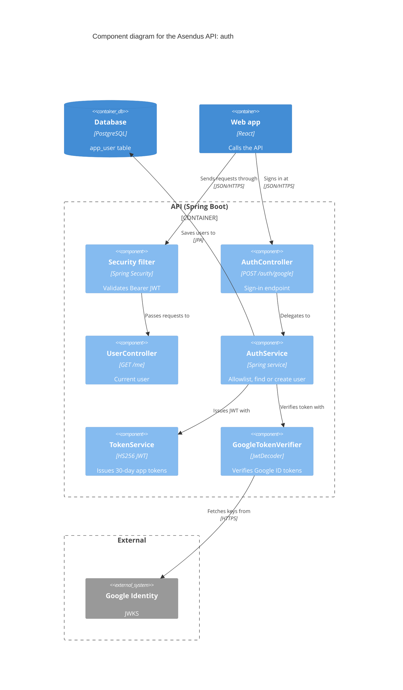

<!-- generated from 8b44d9dcceaa, 2026-10-15 -->
<!-- c4-map config abedddd81c0a -->

# API components: auth

How sign-in works and how requests are authenticated. The web app sends a Google ID token to `POST /auth/google`. The API verifies it against Google's keys, checks the email allowlist, and returns its own 30-day HS256 JWT. All later requests carry that JWT, and Spring Security's resource-server filter validates it. The feature modules are in [timetables](c4-components-timetable.md) and [days and duties](c4-components-days-duties.md).

