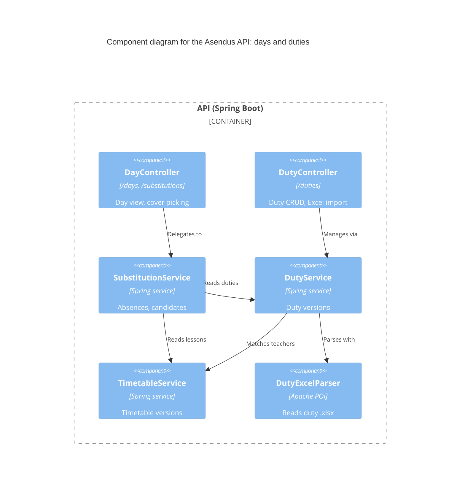

<!-- generated from 8b44d9dcceaa, 2026-10-15 -->
<!-- c4-map config abedddd81c0a -->

# API components: days and duties

The daily cover work in `substitution` and the duty import in `duty`. Each service reads and writes the database through its own Spring Data JPA repositories (not drawn). Both parsers report anything they can't read safely as a warning and never guess. See also [timetables](c4-components-timetable.md) and [auth](c4-components-auth.md).

