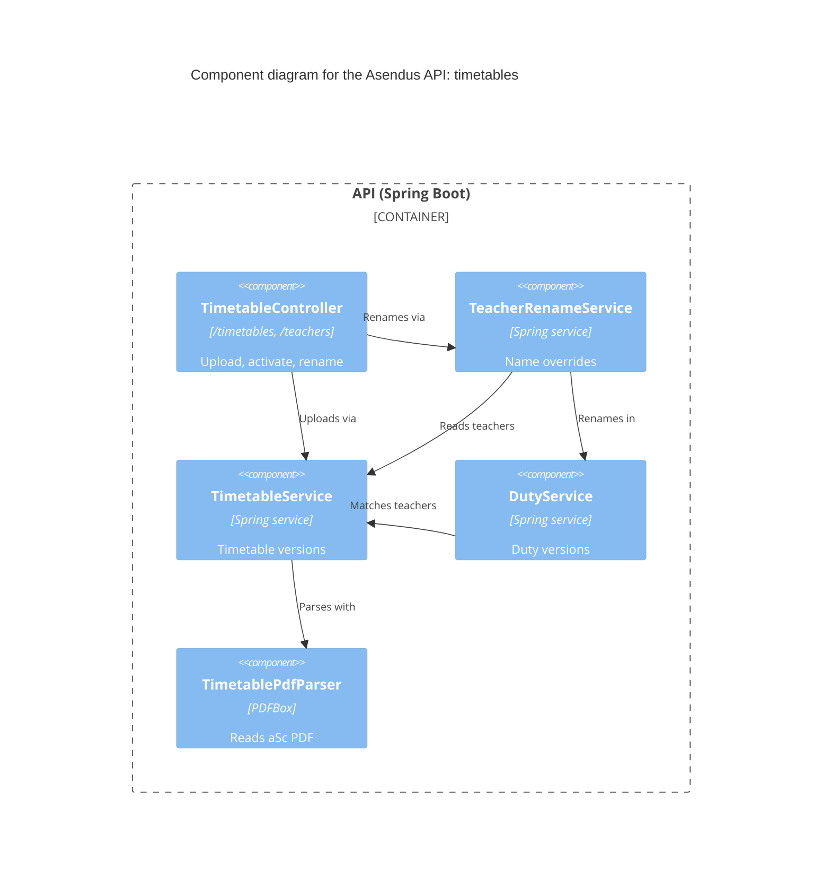

<!-- generated from 8b44d9dcceaa, 2026-10-15 -->
<!-- c4-map config abedddd81c0a -->

# API components: timetables

Uploading, activating and renaming in the `timetable` package. `timetable` and `duty` import each other: `DutyService` matches duty names against the active timetable's teachers, and `TeacherRenameService` renames a teacher in both. See also [days and duties](c4-components-days-duties.md) and [auth](c4-components-auth.md).

