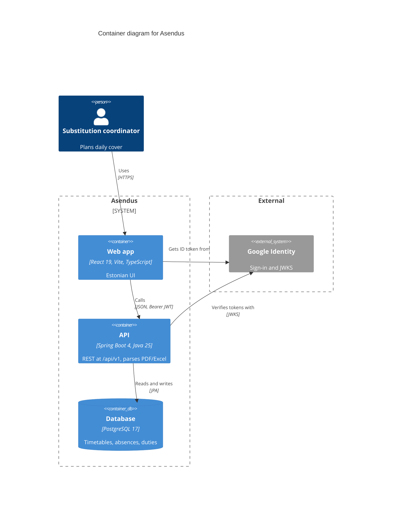

<!-- generated from 8b44d9dcceaa, 2026-10-15 -->
<!-- c4-map config abedddd81c0a -->

# Containers

The browser loads a React SPA from Cloudflare Pages. The SPA gets a Google ID token, exchanges it for an Asendus JWT at `POST /api/v1/auth/google`, and sends that JWT on every later call. Flyway owns the schema (`api/src/main/resources/db/migration/`) and Hibernate only validates it.

