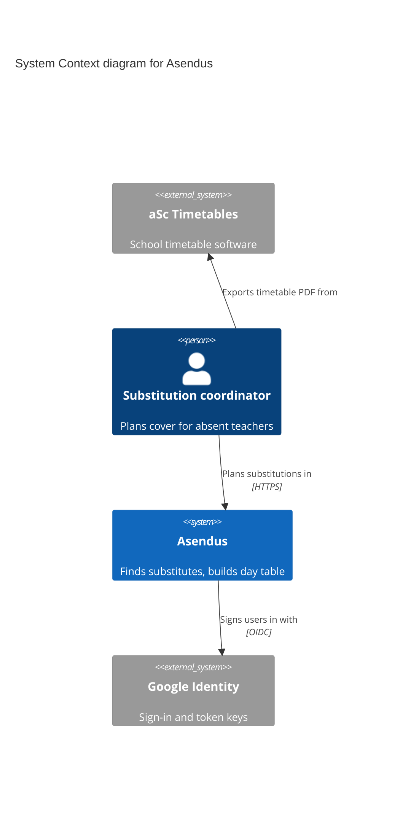

<!-- generated from 953ce3a65125, 2026-10-23 -->
<!-- c4-map config abedddd81c0a -->

# System context

Asendus has one kind of user: the school's substitution coordinator. Sign-in goes through Google and only allowlisted emails get in. The timetable comes from aSc as a PDF export that the coordinator uploads by hand. Asendus never calls aSc.

