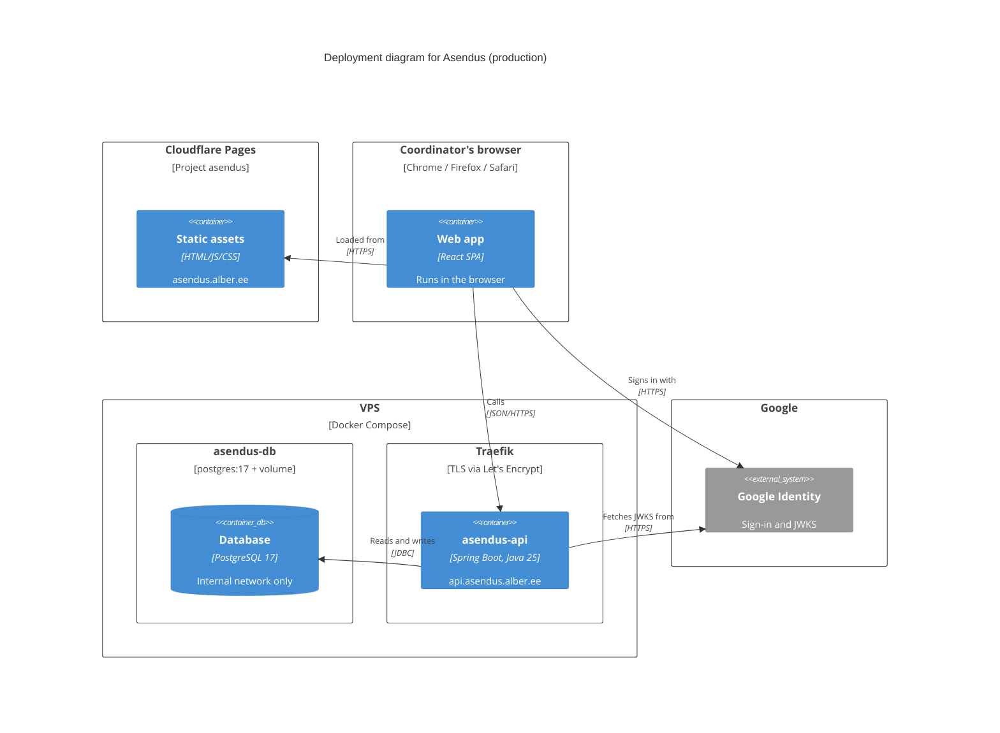

# Deployment

Pushing to `main` deploys both halves. `deploy-web.yml` tests and builds the SPA, then uploads it to Cloudflare Pages. `deploy-api.yml` builds the API image, pushes it to Docker Hub and runs `docker compose up -d` on the VPS with `docker-compose.prod.yml`. API tests run in `verify-api.yml` on pull requests, not on deploy.

