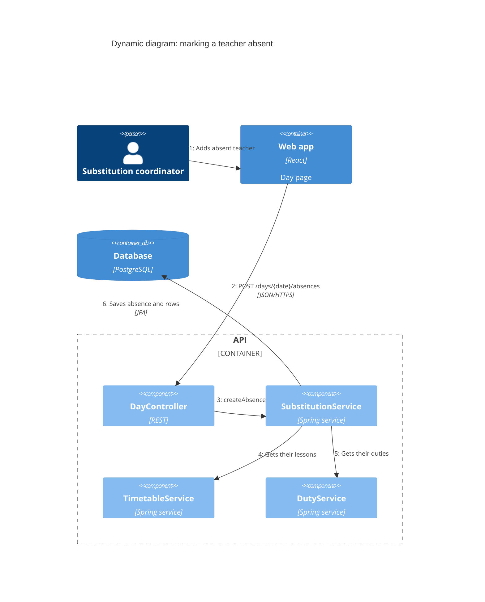

# Substitution flow

The core daily task. Marking a teacher absent saves one open substitution row for each lesson and break duty they have in the chosen periods. After that, the coordinator fills each row: the Day page calls `GET /days/{date}/candidates?period=…` for the eligible teachers, then `PUT /substitutions/{id}` with the chosen one. Both go through `DayController` → `SubstitutionService`.

