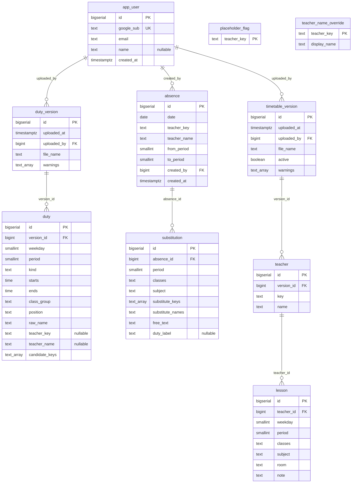

<!-- generated from 8b44d9dcceaa, 2026-10-15 -->
<!-- c4-map config abedddd81c0a -->

> **Agent context map.** Dense on purpose and not laid out for viewing; labels may overlap when rendered. Diagrams for people: [docs/architecture/](../architecture/).

# Database schema

Generated from 4 SQL migrations in `api/src/main/resources/db/migration` (latest: `V4__teacher_name_override.sql`). Columns only: no defaults or checks. PK primary key, FK foreign key, UK unique.

Composite unique keys: `absence` (date, teacher_key); `teacher` (version_id, key).
