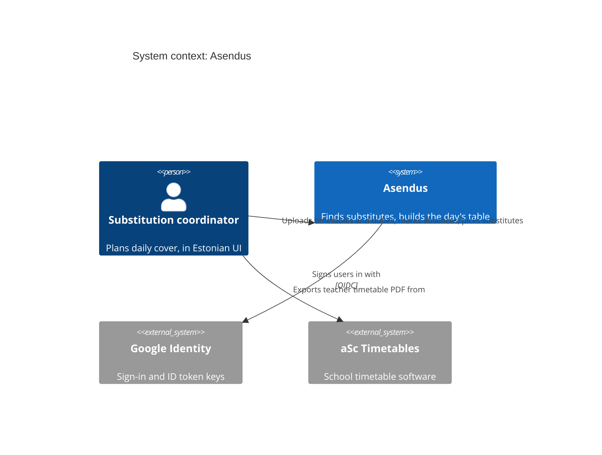

<!-- generated from 953ce3a65125, 2026-10-23 -->
<!-- c4-map config abedddd81c0a -->

> **Agent context map.** Dense on purpose and not laid out for viewing; labels may overlap when rendered. Diagrams for people: [docs/architecture/](../architecture/).

# Level 1: System context

Asendus helps one school's substitution coordinator cover absent teachers. Sign-in is Google-only and limited to an email allowlist (`ALLOWED_EMAILS`). The timetable and duty schedules come in as files the coordinator uploads; Asendus has no live link to aSc.

- Inputs: aSc teacher-timetable PDF (README), duty schedule Excel `.xlsx` (`DutyExcelParser`).
- Output: the day's substitution table, copied or printed by the coordinator (README).
