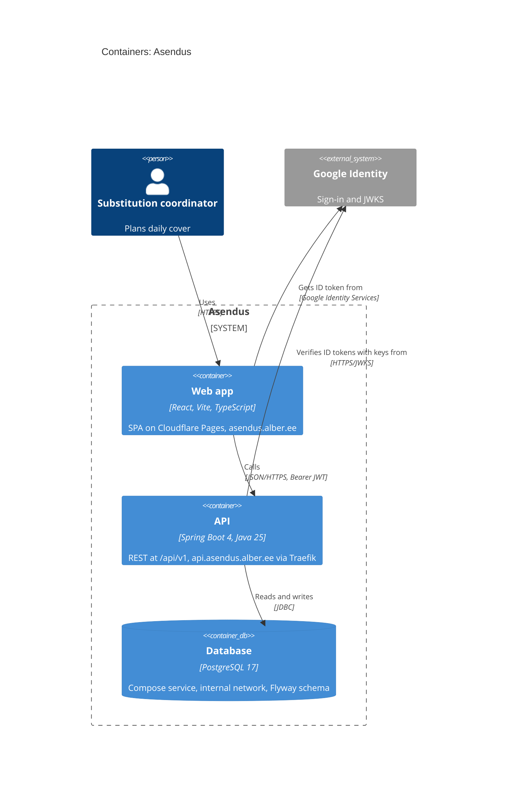

<!-- generated from 8b44d9dcceaa, 2026-10-15 -->
<!-- c4-map config abedddd81c0a -->

> **Agent context map.** Dense on purpose and not laid out for viewing; labels may overlap when rendered. Diagrams for people: [docs/architecture/](../architecture/).

# Level 2: Containers

Production per `docker-compose.prod.yml` and `.github/workflows/`: the SPA is static on Cloudflare Pages; the API and Postgres run as Docker Compose services on a VPS behind Traefik. The SPA gets a Google ID token, exchanges it at `POST /api/v1/auth/google` for a 30-day app JWT, and sends that as a Bearer token on every call.

- Deploy: push to `main` builds the API image to Docker Hub and runs `docker compose up -d` on the VPS (`deploy-api.yml`); `web/**` changes build and upload to Cloudflare Pages (`deploy-web.yml`).
- Config: API from the VPS `.env` (`GOOGLE_CLIENT_IDS`, `JWT_SECRET`, `ALLOWED_EMAILS`, `CORS_ALLOWED_ORIGINS`, Postgres credentials); web at build time (`VITE_API_URL`, `VITE_GOOGLE_CLIENT_ID`).
- Local dev: `api/compose.yaml` starts Postgres on port 5433; Vite dev server on 5173.
