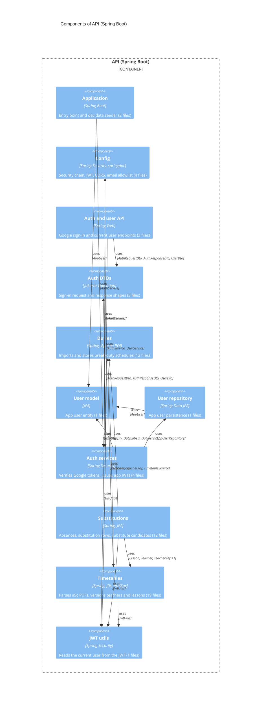
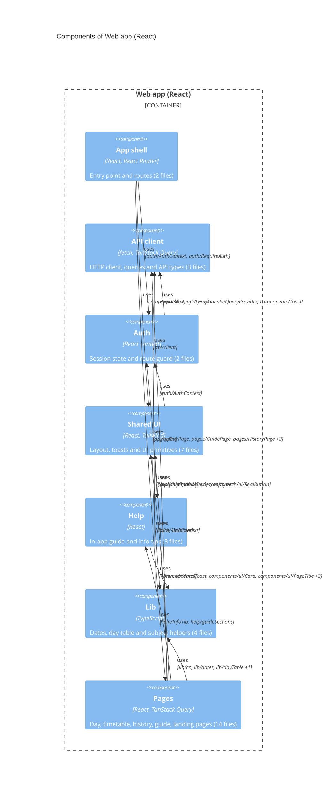

<!-- generated from 8b44d9dcceaa, 2026-10-15 -->
<!-- c4-map config abedddd81c0a -->

> **Agent context map.** Dense on purpose and not laid out for viewing; labels may overlap when rendered. Diagrams for people: [docs/architecture/](../architecture/).

# Level 3: Components

Generated from source imports. A component is a directory (or package) at the configured depth; an arrow means code in one component imports the other, labelled with what it imports. Container context: [level-2.md](level-2.md).

## API (Spring Boot)

Root `api/src/main/java`, depth 1.

## Web app (React)

Root `web/src`, depth 1.

